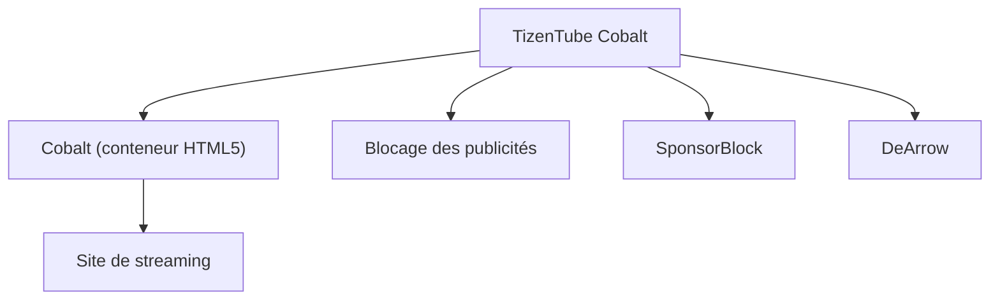

# reisxd/TizenTubeCobalt

> Application basée sur Cobalt qui retire les publicités d'un site de vidéo en streaming sur télévision.

## Le problème
Regarder des vidéos en streaming sur un téléviseur ou un boîtier impose publicités, titres trompeurs et segments sponsorisés.

## Ce que ça fait vraiment
Fournit une application bâtie sur Cobalt, le conteneur HTML5 léger de Google pour appareils contraints. Elle bloque les publicités, saute les segments sponsorisés (SponsorBlock), règle la vitesse de lecture et nettoie les titres accrocheurs (DeArrow). Le README est court : les détails techniques ne sont pas documentés.

## Comment c'est branché
Schéma simplifié d'après la fiche, sans diagramme fourni.

## Essayer
Aucune commande documentée dans le README : télécharger la dernière version depuis les releases, puis l'installer sur l'appareil par gestionnaire de fichiers, ADB ou la méthode propre à la plateforme.

## Coût et pièges
Gratuit. L'installation se fait par chargement latéral. Le README conseille un appareil certifié Google TV.

## Ce que ce n'est pas
Pas une application officielle du service de streaming. Le contournement des publicités peut contrevenir aux conditions d'usage du site. Le README ne dit rien de l'architecture ni des appareils précisément pris en charge.

## Alternatives
Aucune alternative nommée dans le README.

## Pour toi
À ignorer : application de télévision sans rapport avec la data ou l'IA, et trop peu documentée pour être évaluée.

