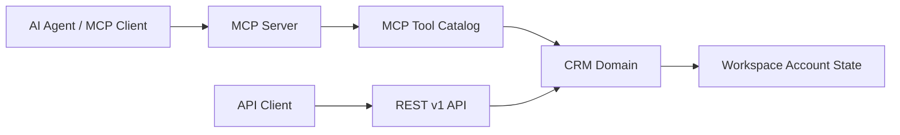

# relaticle/relaticle

> A self-hosted CRM in Laravel/Filament, with an MCP server and REST API for plugging in AI agents.

## The problem
CRMs are closed and poorly accessible to AI agents; you need a CRM whose data you own and that an agent can read and write.

## What it actually does
A multi-workspace CRM (companies, people, opportunities, tasks, notes) with custom fields (22 types, per-field encryption), a REST v1 API and an MCP server exposing tools per entity. It also includes a built-in chat agent, an import assistant, Stripe billing and an admin console. Requirements: PHP 8.5+, PostgreSQL 17+, Composer 2, Node.js 22+, Redis optional.

## How it is wired


## Trying it
```bash
git clone https://github.com/Relaticle/relaticle.git
cd relaticle && composer app-install
composer dev
composer test
```

## Cost and gotchas
Free when self-hosted; PostgreSQL 17 and PHP 8.5 are recent. Stripe concerns the hosted offering.

## What it is not
Not an enterprise-ready CRM without operations work: you host and secure it. AGPL-3.0: modifications served over a network must be published.

## Alternatives
No alternative named in the README.

## For you
Worth watching: an MCP server on a CRM is a good textbook case of a tooled agent, but the PHP stack is far from your daily work.
