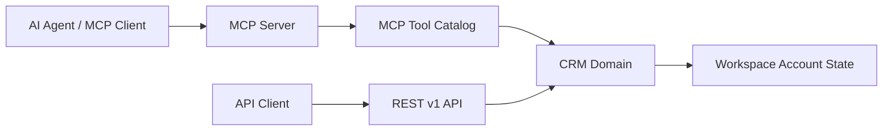

# relaticle/relaticle

> CRM auto-hébergé en Laravel/Filament, avec serveur MCP et API REST pour y brancher des agents IA.

## Le problème
Les CRM sont fermés et peu accessibles aux agents IA ; il faut un CRM dont on possède les données et qu'un agent peut lire et écrire.

## Ce que ça fait vraiment
CRM multi-espaces de travail (entreprises, personnes, opportunités, tâches, notes) avec champs personnalisés (22 types, chiffrement par champ), API REST v1 et serveur MCP exposant des outils par entité. Contient aussi un agent de chat intégré, un assistant d'import, de la facturation Stripe et une console d'administration. Prérequis : PHP 8.5+, PostgreSQL 17+, Composer 2, Node.js 22+, Redis optionnel.

## Comment c'est branché


## Essayer
```bash
git clone https://github.com/Relaticle/relaticle.git
cd relaticle && composer app-install
composer dev
composer test
```

## Coût et pièges
Gratuit en auto-hébergement ; PostgreSQL 17 et PHP 8.5 sont récents. Stripe concerne l'offre hébergée.

## Ce que ce n'est pas
Pas un CRM prêt pour l'entreprise sans exploitation : tu héberges et sécurises. AGPL-3.0 : les modifications servies en réseau doivent être publiées.

## Alternatives
Aucune alternative nommée dans le README.

## Pour toi
À surveiller : le serveur MCP sur un CRM est un bon cas d'école d'agent outillé, mais le stack PHP est loin de ton quotidien.

