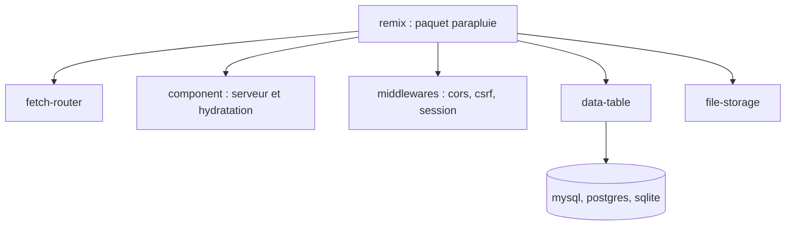

# remix-run/remix

> Remix 3 web framework, assembled from small standalone packages built on Web APIs, for JavaScript developers.

## The problem
Web frameworks pile up dependencies and compilers, which ties the code to a tool and a roadmap.

## What it actually does
A `remix` package bundles many standalone packages: Fetch router, components with server rendering and hydration, middlewares (cors, csrf, sessions), data access (data-table with MySQL, PostgreSQL, SQLite), file storage, multipart and tar parsers. The code relies on Web APIs and runs on Node.js, Bun, Deno, Cloudflare Workers. The project claims to be optimized for LLMs.

## How it is wired

The provided diagram describes an older version of Remix; this one follows the README's package list.

## Trying it
```bash
npm i remix
npx remix new my-remix-app
```

## Cost and gotchas
Free. The README announces active development: the API may still change. PR previews are deleted after 7 to 30 days, which can break dependency pinning.

## What it is not
Not Remix version 2, nor a data / AI tool. Not a stabilized project.

## Alternatives
No alternative named in the README.

## For you
Ignore: web framework under construction, unrelated to data / AI / MLOps work.
