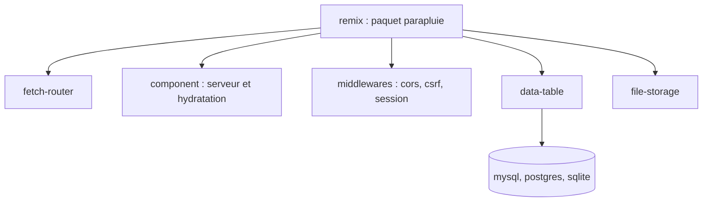

# remix-run/remix

> Framework web Remix 3, assemblé de petits paquets autonomes fondés sur les API Web, pour développeurs JavaScript.

## Le problème
Les frameworks web empilent des dépendances et des compilateurs, ce qui lie le code à un outil et à une feuille de route.

## Ce que ça fait vraiment
Un paquet `remix` regroupe de nombreux paquets autonomes : routeur Fetch, composants avec rendu serveur et hydratation, middlewares (cors, csrf, sessions), accès aux données (data-table avec MySQL, PostgreSQL, SQLite), stockage de fichiers, analyseurs multipart et tar. Le code s'appuie sur les API Web et s'exécute sur Node.js, Bun, Deno, Cloudflare Workers. Le projet se dit optimisé pour les LLM.

## Comment c'est branché

Le diagramme fourni décrit une ancienne version de Remix ; celui-ci suit la liste de paquets du README.

## Essayer
```bash
npm i remix
npx remix new my-remix-app
```

## Coût et pièges
Gratuit. Le README annonce un développement actif : l'API peut encore changer. Les préversions de PR sont supprimées après 7 à 30 jours, ce qui peut casser un verrouillage de dépendances.

## Ce que ce n'est pas
Pas la version 2 de Remix, ni un outil data / IA. Pas un projet stabilisé.

## Alternatives
Aucune alternative nommée dans le README.

## Pour toi
À ignorer : framework web en chantier, sans lien avec un travail data / IA / MLOps.

