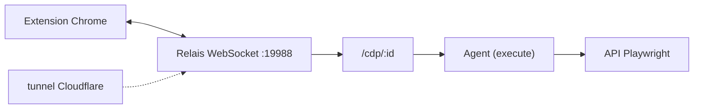

# remorses/playwriter

> Chrome extension and CLI that let an agent drive your already logged-in browser with the Playwright API.

## The problem
Browser MCPs launch a fresh Chrome, with no sessions, easily spotted by bot detectors.

## What it actually does
A Chrome extension links, through a local WebSocket (port 19988), a Node relay to the tab you activate. A single `execute` tool gives access to the full Playwright API, with persistent state per session, accessibility labels, debugger, hot editing and screenshots. A "remote control" mode lends your browser through a Cloudflare tunnel. The README says anonymous telemetry goes to Strada, and can be disabled.

## How it is wired


## Trying it
```bash
npm i -g playwriter
playwriter session new
playwriter -s 1 -e 'state.page = await context.newPage(); await state.page.goto("https://example.com")'
```

## Cost and gotchas
Free. The agent acts in your real session: cookies and accounts exposed. `PLAYWRITER_TELEMETRY=0` turns telemetry off. Remote control is not a sandbox.

## What it is not
Not an isolated browser: it acts with your credentials. The comparison in the README is the author's own.

## Alternatives
- Playwright MCP, BrowserMCP, agent-browser: cited; separate browsers or more numerous tools.

## For you
To adopt for scraping or authenticated automation: a familiar Playwright API and a single lightweight tool in context, to be used with caution on your profile.
