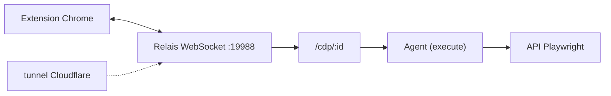

# remorses/playwriter

> Extension Chrome et CLI qui laissent un agent piloter ton navigateur déjà connecté avec l'API Playwright.

## Le problème
Les MCP navigateur lancent un Chrome neuf, sans sessions, repérable par les détecteurs de bots.

## Ce que ça fait vraiment
Une extension Chrome relie, par WebSocket local (port 19988), un relais Node à l'onglet que tu actives. Un seul outil `execute` donne accès à l'API Playwright complète, avec état persistant par session, étiquettes d'accessibilité, débogueur, édition à chaud et captures. Un mode « contrôle à distance » prête ton navigateur via tunnel Cloudflare. Le README dit que la télémétrie anonyme part chez Strada, désactivable.

## Comment c'est branché


## Essayer
```bash
npm i -g playwriter
playwriter session new
playwriter -s 1 -e 'state.page = await context.newPage(); await state.page.goto("https://example.com")'
```

## Coût et pièges
Gratuit. L'agent agit dans ta session réelle : cookies et comptes exposés. `PLAYWRITER_TELEMETRY=0` coupe la télémétrie. Le contrôle à distance n'est pas un bac à sable.

## Ce que ce n'est pas
Pas un navigateur isolé : il agit avec tes identifiants. Le README comparatif est celui de l'auteur.

## Alternatives
- Playwright MCP, BrowserMCP, agent-browser : cités ; navigateurs séparés ou outils plus nombreux.

## Pour toi
À adopter pour du scraping ou de l'automatisation authentifiée : API Playwright connue et un seul outil léger en contexte, à utiliser avec prudence sur ton profil.

