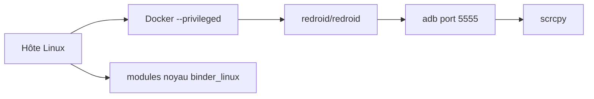

# remote-android/redroid-doc

> Documentation for redroid, which runs Android instances in Linux containers, for testing and cloud use.

## The problem
Running several Android instances for test automation or virtual phones usually requires heavy emulators, poorly suited to Linux container hosts.

## What it actually does
redroid (Remote anDroid) is a cloud Android solution with GPU acceleration: you start Docker, podman or k8s containers that embed Android 8.1 to 16, in arm64 or amd64. You connect through adb on port 5555 and can view the screen with scrcpy. `androidboot.*` parameters set the display, network, proxy and GPU mode. The repository is the documentation, not the code.

## How it is wired
Simplified diagram based on the sheet, no diagram provided.


## Trying it
```bash
apt install linux-modules-extra-`uname -r`
modprobe binder_linux devices="binder,hwbinder,vndbinder"
modprobe ashmem_linux
docker run -itd --rm --privileged --pull always -v ~/data:/data -p 5555:5555 redroid/redroid:12.0.0_64only-latest
adb connect localhost:5555
scrcpy -s localhost:5555
```

## Cost and gotchas
`--privileged` container and kernel modules to load: the host is exposed. The README warns never to open the adb port on a public network, at the risk of compromising the container or even the host.

## What it is not
Not a turnkey emulator for a workstation: it needs a Linux kernel with certain features. WebRTC is only announced as planned. No license is declared in the catalog.

## Alternatives
No alternative is named in the README (cuttlefish is cited as inspiration for the future WebRTC).

## For you
Worth watching: useful if you must drive Android instances at scale for testing, but the missing license, a single contact and a privileged container make it risky outside a lab.
