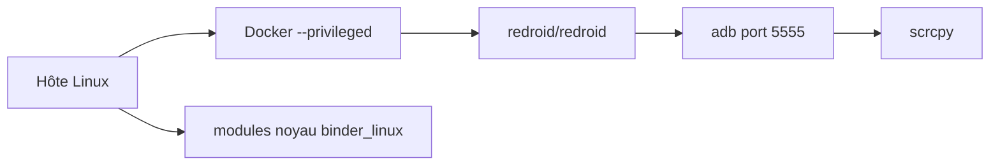

# remote-android/redroid-doc

> Documentation de redroid, qui fait tourner des instances Android dans des conteneurs Linux, pour tests et cloud.

## Le problème
Lancer plusieurs instances Android pour l'automatisation de tests ou des téléphones virtuels demande d'habitude des émulateurs lourds, peu adaptés à des hôtes Linux en conteneurs.

## Ce que ça fait vraiment
redroid (Remote anDroid) est une solution Android dans le cloud avec accélération GPU : on démarre des conteneurs Docker, podman ou k8s qui embarquent Android 8.1 à 16, en arm64 ou amd64. On se connecte via adb sur le port 5555 et on peut voir l'écran avec scrcpy. Des paramètres `androidboot.*` règlent l'écran, le réseau, le proxy et le mode GPU. Le dépôt est la documentation, pas le code.

## Comment c'est branché
Schéma simplifié d'après la fiche, sans diagramme fourni.


## Essayer
```bash
apt install linux-modules-extra-`uname -r`
modprobe binder_linux devices="binder,hwbinder,vndbinder"
modprobe ashmem_linux
docker run -itd --rm --privileged --pull always -v ~/data:/data -p 5555:5555 redroid/redroid:12.0.0_64only-latest
adb connect localhost:5555
scrcpy -s localhost:5555
```

## Coût et pièges
Conteneur `--privileged` et modules noyau à charger : l'hôte est exposé. Le README avertit de ne jamais ouvrir le port adb sur un réseau public, sous peine de compromettre le conteneur voire l'hôte.

## Ce que ce n'est pas
Pas un émulateur clé en main pour poste de travail : il faut un noyau Linux avec certaines fonctions. Le WebRTC est seulement annoncé comme prévu. Aucune licence n'est déclarée dans le catalogue.

## Alternatives
Aucune alternative nommée dans le README (cuttlefish est cité comme source d'inspiration pour le futur WebRTC).

## Pour toi
À surveiller : utile si tu dois piloter des Android en masse pour des tests, mais licence absente, un seul contact et conteneur privilégié le rendent risqué hors labo.

