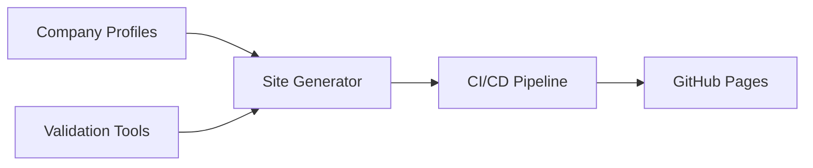

# remoteintech/remote-jobs

> Source code of the remoteintech.company website, a community directory of remote-friendly tech companies.

## The problem
The README does not say so; the purpose is to list tech companies that accept remote work.

## What it actually does
Minimal README (under 800 characters): this repository is the site's code, and the directory itself is browsed at remoteintech.company. The site is built with Eleventy Excellent (Lene Saile) and requires Node.js 22+. Based on the architecture: company profiles in Markdown, an index, a site generator, validation tools, CI and static hosting.

## How it is wired


## Trying it
```bash
npm install
npm run start
npm run build
```

## Cost and gotchas
Free. A license is present but not identified by GitHub: check it before reusing. The content of the profiles is not described in the README.

## What it is not
Not a job board or a recruiting platform: it is a directory of companies.

## Alternatives
- No alternative named in the README.

## For you
Ignore: a directory of remote companies is not part of a data/AI/MLOps workflow, except for your own job search.
