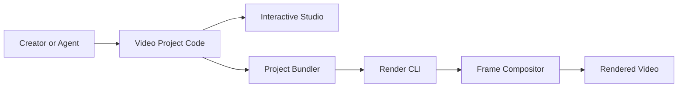

# remotion-dev/remotion

> Tools to create and automate videos with React code, by hand or through an agent.

## The problem
Producing many video variants from data is impractical with a manual editor.

## What it actually does
Videos are React compositions; the code remains the source of truth. A Studio allows interactive editing, a CLI runs local or cloud rendering (Lambda, Cloud Run, Vercel). It also provides animations, subtitles, audio, effects, a player and a starter editor.

## How it is wired


## Trying it
```console
npx create-video@latest
```

## Cost and gotchas
The README points to a commercial license page and a shop; the license is not identified by GitHub. Large-scale rendering requires your own infrastructure or a cloud.

## What it is not
Not conventional editing software: you program the videos.

## Alternatives
No alternative named in the README.

## For you
Worth watching: useful for generating report or demo videos from data, but the commercial license needs checking.
