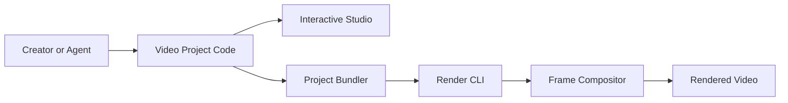

# remotion-dev/remotion

> Outils pour créer et automatiser des vidéos avec du code React, à la main ou via un agent.

## Le problème
Produire de nombreuses vidéos variantes à partir de données est impraticable avec un éditeur manuel.

## Ce que ça fait vraiment
Les vidéos sont des compositions React ; le code reste la source de vérité. Un Studio permet l'édition interactive, une CLI lance le rendu local ou cloud (Lambda, Cloud Run, Vercel). Fournit aussi animations, sous-titres, audio, effets, lecteur et un éditeur de départ.

## Comment c'est branché


## Essayer
```console
npx create-video@latest
```

## Coût et pièges
Le README renvoie vers une page de licence commerciale et une boutique ; la licence n'est pas identifiée par GitHub. Le rendu à grande échelle suppose ta propre infrastructure ou un cloud.

## Ce que ce n'est pas
Pas un logiciel de montage classique : on programme les vidéos.

## Alternatives
Aucune alternative nommée dans le README.

## Pour toi
À surveiller : utile pour générer des vidéos de rapports ou de démos depuis des données, mais la licence commerciale demande vérification.

