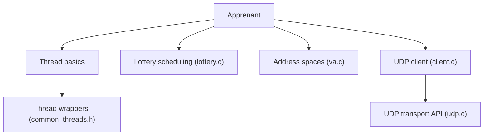

# remzi-arpacidusseau/ostep-code

> C code examples accompanying the free OSTEP operating systems textbook.

## The problem
Understanding scheduling, virtual memory and concurrency is easier by reading and running code than with theory alone.

## What it actually does
Collection of independent C examples: process API, scheduling (lottery), address spaces, threads, locks, condition variables, semaphores (philosophers, producer-consumer) and a UDP client-server. The README mostly lists the chapters, some of which have no code in the tree.

## How it is wired
Diagram based on the provided diagram.

## Trying it
No documented command. Each chapter folder contains C files to compile one by one with a C compiler.

## Cost and gotchas
Free. No license declared: reuse is not guaranteed. Last commit in November 2023. The examples do not form an application.

## What it is not
Not the book: the text is on ostep.org. Not a simulation framework, nor a single integrated program.

## Alternatives
No alternative named in the README.

## For you
Ignore as a tool: consult only if you want to review system basics (concurrency, memory) useful for understanding MLOps.
