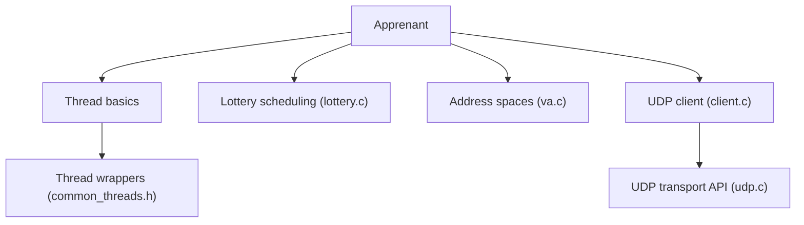

# remzi-arpacidusseau/ostep-code

> Exemples de code en C accompagnant le manuel gratuit sur les systèmes d'exploitation OSTEP.

## Le problème
Comprendre ordonnancement, mémoire virtuelle et concurrence est plus facile en lisant et exécutant du code qu'avec la seule théorie.

## Ce que ça fait vraiment
Collection d'exemples C indépendants : API de processus, ordonnancement (loterie), espaces d'adressage, threads, verrous, variables de condition, sémaphores (philosophes, producteur-consommateur) et client-serveur UDP. Le README liste surtout les chapitres, dont certains n'ont pas de code dans l'arbre.

## Comment c'est branché
Schéma d'après le diagramme fourni.

## Essayer
Aucune commande documentée. Chaque dossier de chapitre contient des fichiers C à compiler un par un avec un compilateur C.

## Coût et pièges
Gratuit. Aucune licence déclarée : réutilisation non garantie. Dernier commit en novembre 2023. Les exemples ne forment pas une application.

## Ce que ce n'est pas
Pas le livre : le texte est sur ostep.org. Pas un cadre de simulation, ni un programme unique intégré.

## Alternatives
Aucune alternative nommée dans le README.

## Pour toi
À ignorer comme outil : à consulter seulement si tu veux réviser les bases système (concurrence, mémoire) utiles pour comprendre le MLOps.

