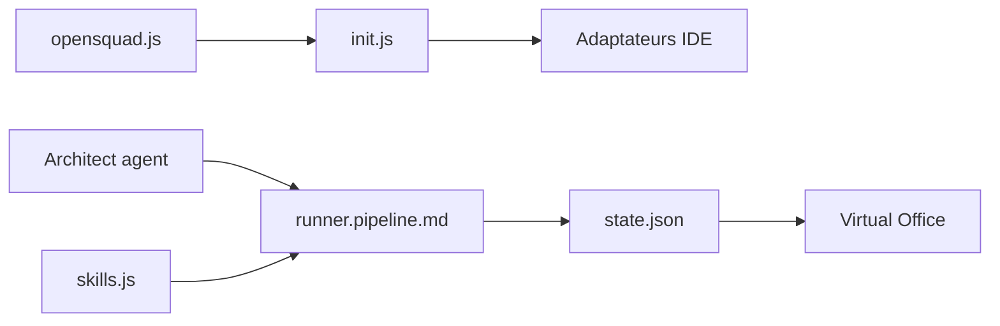

# renatoasse/opensquad

> Multi-agent orchestration framework launched from the IDE, for building pipelined teams of AI agents.

## The problem
Chaining research, writing and design across several agents requires a pipeline and human-validation framework.

## What it actually does
The Node CLI installs IDE-specific instructions into your project (Claude Code, Cursor, Codex, Gemini CLI…) and a squad system: an Architect designs agents, tasks and pipeline, with checkpoints. Execution and permissions are left to the host IDE. Installable skills, Playwright browsing and a 2D dashboard (React and Phaser).

## How it is wired


## Trying it
```bash
npx opensquad init
npx opensquad update
npx serve squads/<nom-du-squad>/dashboard
```
Then, in the IDE: `/opensquad`, `/opensquad create`, `/opensquad run <squad>`.

## Cost and gotchas
Free as software, but every run consumes paid tokens on Claude Code or the OpenAI API. Browser cookies may be kept in `_opensquad/_browser_profile/`.

## What it is not
Not an agent server: it supplies prompts. Checkpoints are only instructions. The catalogue shows no licence, whereas the README claims MIT.

## Alternatives
No alternative named in the README.

## For you
Worth watching: an interesting squad-of-agents approach, but the licence is undeclared in the catalogue and token costs need measuring.
