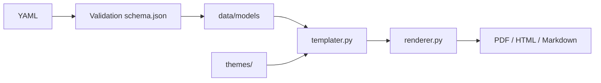

# rendercv/rendercv

> PDF resume generator from a YAML file, for academics and engineers.

## The problem
Laying out a resume by hand in a word processor is tedious, not versionable and inconsistent.

## What it actually does
You write your resume in YAML (with Markdown), RenderCV strictly validates it with a JSON schema (editor autocompletion), translates it to Typst and then to PDF; it can also output Markdown and HTML. Nine themes, design options (margins, colors, typography), configurable languages. An installable agent skill (`rendercv/rendercv-skill`) lets an agent create or edit your resume.

## How it is wired


## Trying it
```bash
pip install "rendercv[full]"
rendercv new "John Doe"
rendercv render "John_Doe_CV.yaml"
npx skills add rendercv/rendercv-skill
```

## Cost and gotchas
Free. Python 3.12+ required. Do not put real personal data in a public repository.

## What it is not
It is not a visual editor nor a job application service: it is a text-to-PDF compiler.

## Alternatives
The README cites no alternative.

## For you
Adopt: a resume versioned in YAML is updated like code and lends itself well to agent assistance.
