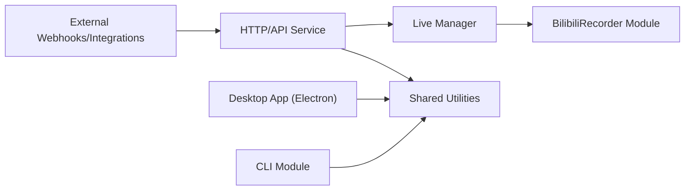

# renmu123/biliLive-tools

> Chinese toolbox for recording livestreams, burning in comments and publishing to Bilibili.

## The problem
Processing a livestream recording with its comments ("danmaku") requires several programs, sometimes command-line only.

## What it actually does
README in Chinese. Recording from Douyu, Huya, Bilibili, Douyin, Xiaohongshu, TikTok; XML to ASS conversion; burning comments into the video; Bilibili upload; synchronization with network drives; receiving webhooks (BililiveRecorder, blrec, DDTV); comment-based cutting; optionally, music cutting and lyrics assisted by an LLM. pnpm monorepo: Electron application, CLI, HTTP service, API and WebUI containers. The author says no data is collected.

## How it is wired

## Trying it
No command documented in the README: installation by downloading a client (releases); external documentation (docs.irenmu.com).

## Cost and gotchas
Free; FFmpeg and DanmakuFactory are used internally. The targeted platforms are Chinese; Bilibili accounts are required for upload.

## What it is not
Not a streaming tool. Not documented in English in the README.

## Alternatives
BililiveRecorder (recorder cited in the references).

## For you
Ignore: a niche livestream processing chain, unrelated to data/AI/MLOps work.
