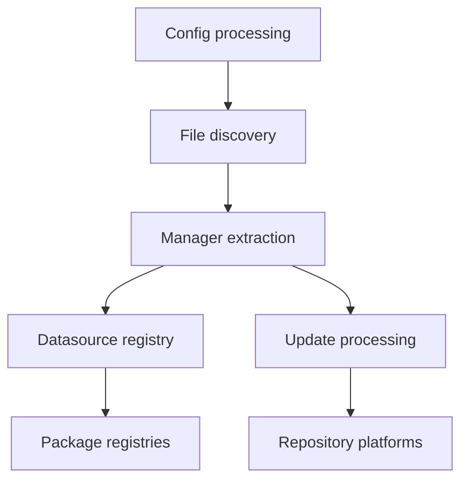

# renovatebot/renovate

> Tool that detects outdated dependencies in a repository and opens update pull requests.

## The problem
Updating dozens of dependencies by hand, without knowing which updates are safe.

## What it actually does
Renovate discovers dependency files, extracts versions through more than 90 package managers, queries the registries, applies grouping rules, then opens PRs on GitHub, GitLab, Bitbucket, Azure DevOps, Gitea and others. It provides age, adoption, success rate and merge confidence.

## How it is wired


## Trying it
```bash
npx renovate
```
The README also mentions a GitHub Action and a GitLab Runner.

## Cost and gotchas
Free when self-hosted; Mend offers cloud plans. An access token for the target platform is required (not detailed in the README). AGPL license.

## What it is not
It is not a vulnerability scanner: it updates versions. Issues are reserved for maintainers, questions go through Discussions.

## Alternatives
Dependabot, via the cited "Renovate vs Dependabot" comparison page.

## For you
Worth adopting: very mature, covers pip, Docker, GitHub Actions and npm, so MLOps repositories stay up to date effortlessly.
