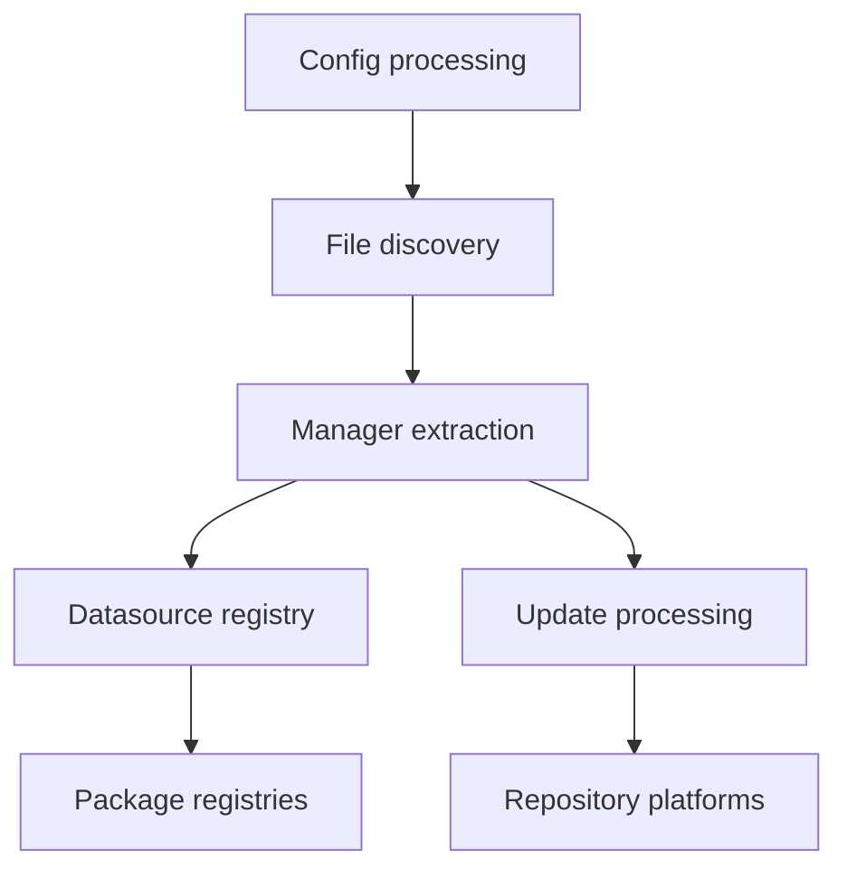

# renovatebot/renovate

> Outil qui détecte les dépendances obsolètes d'un dépôt et ouvre les pull requests de mise à jour.

## Le problème
Mettre à jour à la main des dizaines de dépendances, sans savoir lesquelles sont sûres.

## Ce que ça fait vraiment
Renovate découvre les fichiers de dépendances, extrait les versions via plus de 90 gestionnaires de paquets, interroge les registres, applique des règles de regroupement puis ouvre des PR sur GitHub, GitLab, Bitbucket, Azure DevOps, Gitea et autres. Il fournit âge, adoption, taux de réussite et confiance de fusion.

## Comment c'est branché


## Essayer
```bash
npx renovate
```
Le README mentionne aussi une GitHub Action et un GitLab Runner.

## Coût et pièges
Gratuit en auto-hébergé ; Mend propose des offres cloud. Il faut un jeton d'accès à la plateforme cible (non détaillé dans le README). Licence AGPL.

## Ce que ce n'est pas
Ce n'est pas un scanner de vulnérabilités : il met à jour des versions. Les issues sont réservées aux mainteneurs, les questions passent par Discussions.

## Alternatives
Dependabot, via la page de comparaison « Renovate vs Dependabot » citée.

## Pour toi
À adopter : très mûr, couvre pip, Docker, GitHub Actions et npm, donc les dépôts MLOps restent à jour sans effort.

