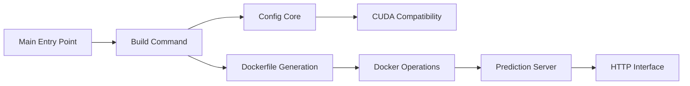

# replicate/cog

> Replicate's CLI that packages an ML model into a Docker image with a generated HTTP API.

## The problem
Shipping a model to production means writing a Dockerfile, an HTTP server, and matching CUDA/cuDNN/PyTorch versions by hand.

## What it actually does
You describe the environment in `cog.yaml` (GPU, system packages, Python, requirements) and the inference in a `Runner` class with typed `setup()` and `run()`. Cog generates the Docker image, picks a compatible CUDA combination, produces an OpenAPI schema and serves a REST API (Rust/Axum server). `cog run`, `cog build`, `cog serve` cover local execution and deployment.

## How it is wired


## Trying it
```bash
brew install replicate/tap/cog
sh <(curl -fsSL https://cog.run/install.sh)
cog run -i image=@input.jpg
cog build -t my-classification-model
cog serve -p 8080
```

## Cost and gotchas
Docker required (plus Buildx with Docker Engine); Windows only via WSL 2. Free locally, you are billed only if you deploy on Replicate.

## What it is not
Not a cluster orchestrator nor an autoscaling tool: it produces an image, and it is up to you to run it. No native Windows support.

## Alternatives
No alternative is named in the README.

## For you
Worth adopting to containerize a model quickly: the `cog.yaml` + typed `Runner` pair tames the CUDA hell and gives a documented API without writing a Dockerfile, exactly what slows the move from notebook to service.
