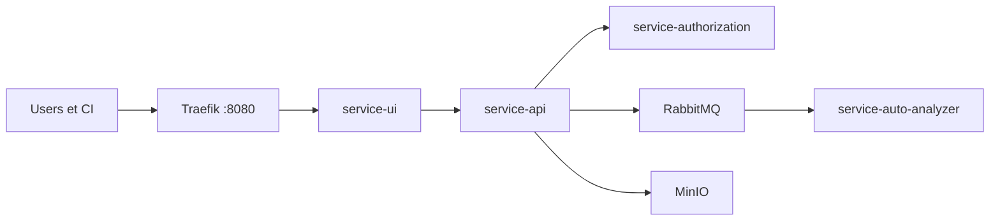

# reportportal/reportportal

> Test reporting platform that aggregates results and logs, with automatic failure analysis.

## The problem
Automated test results are scattered across CI logs and are hard to aggregate and triage.

## What it actually does
Service-based architecture: authorization, API, UI, index (health), analyzer (looks for the probable cause of a failure), Traefik gateway, RabbitMQ (bus) and MinIO (attachments), plus plugins (Jira, Rally, Sauce Labs). On the client side, `client-*`, `agent-*` and `logger-*` adapters send events from the test frameworks.

## How it is wired


## Trying it
```bash
docker compose -p reportportal up
docker compose -p reportportal up -d
# puis http://IP_ADDRESS:8080
```

## Cost and gotchas
Free. Default passwords are published in the README (`default\1q2w3e`, `superadmin\erebus`): change them right away. The example compose file starts every bug-tracker integration, which are resource-hungry. 441 open issues.

## What it is not
Not a test execution tool: it receives results. Should not be deployed to production with the example compose file as is.

## Alternatives
None named in the README.

## For you
Keep an eye on it: useful for tracking tests of ML or MLOps pipelines; the failure analyzer needs to be fed with history.
