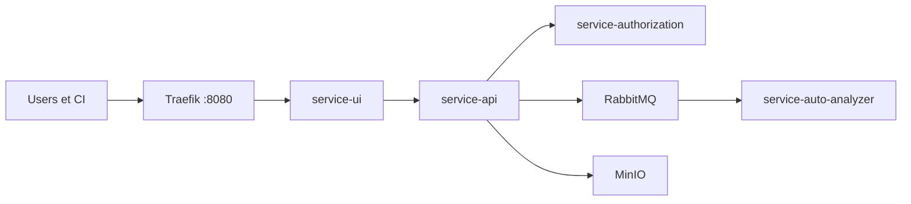

# reportportal/reportportal

> Plateforme de rapports de tests agrégeant résultats et logs, avec analyse automatique des échecs.

## Le problème
Les résultats de tests automatisés sont dispersés dans des logs de CI, difficiles à agréger et à trier.

## Ce que ça fait vraiment
Architecture en services : autorisation, API, interface, index (santé), analyseur (cherche la cause probable d'un échec), passerelle Traefik, RabbitMQ (bus) et MinIO (pièces jointes), plus des plugins (Jira, Rally, Sauce Labs). Côté client, des adaptateurs `client-*`, `agent-*` et `logger-*` envoient les événements depuis les frameworks de test.

## Comment c'est branché


## Essayer
```bash
docker compose -p reportportal up
docker compose -p reportportal up -d
# puis http://IP_ADDRESS:8080
```

## Coût et pièges
Gratuit. Mots de passe par défaut publiés dans le README (`default\1q2w3e`, `superadmin\erebus`) : à changer tout de suite. Le compose d'exemple lance toutes les intégrations de suivi de bogues, gourmandes en ressources. 441 issues ouvertes.

## Ce que ce n'est pas
Pas un outil d'exécution de tests : il reçoit des résultats. Ne se déploie pas en production avec le compose d'exemple tel quel.

## Alternatives
Aucune nommée dans le README.

## Pour toi
Surveiller : utile pour suivre les tests de pipelines ML ou MLOps ; l'analyseur d'échecs demande de lui fournir de l'historique.

