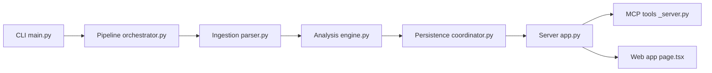

# repowise-dev/repowise

> Local index of a codebase (graph, git, health, decisions) exposed to agents via MCP, for teams.

## The problem
An agent rediscovers on every task who calls what, what breaks and why the code is the way it is: grep, read, re-read, tokens burned.

## What it actually does
Indexes a repository without an API key: call graph across 27 languages, git history, health score (53 detectors), dead code, change risk, impacted tests, architecture decisions. Ten task-oriented MCP tools, a dashboard, CI gates (SARIF) and a multi-repo workspace. LLM documentation generation is optional.

## How it is wired


## Trying it
```bash
uv tool install repowise
repowise init --yes --no-prose
repowise serve
repowise risk main..HEAD
repowise health
repowise distill pytest
```

## Cost and gotchas
Free under AGPL-3.0, with a commercial offer and a hosted offer (your code then goes to them). Anonymous CLI telemetry is on by default (`repowise telemetry disable`). Full indexing is slow: 366.8 s on django, according to the README.

## What it is not
Not a compliance certificate: it holds no SOC 2 or ISO 27001 certification. About 14% of the call edges drawn are wrong, by the README's own admission. The benchmarks are the vendor's.

## Alternatives
- CodeGraph: index much faster to build.
- Serena: 29 MCP tools, for semantic navigation.
- CodeScene: proprietary health score, shorter and more precise list.

## For you
Worth watching: very complete for a fleet of agents on large repositories, but the AGPL, the telemetry and slow indexing weigh on personal use.
