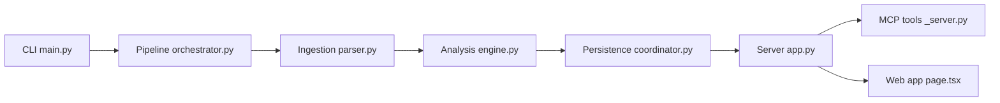

# repowise-dev/repowise

> Index local d'une base de code (graphe, git, santé, décisions) exposé aux agents par MCP, pour équipes.

## Le problème
Un agent redécouvre à chaque tâche qui appelle quoi, ce qui casse et pourquoi le code est ainsi : grep, lecture, relecture, tokens brûlés.

## Ce que ça fait vraiment
Indexe un dépôt sans clé d'API : graphe d'appels sur 27 langages, historique git, score de santé (53 détecteurs), code mort, risque de changement, tests impactés, décisions d'architecture. Dix outils MCP orientés tâche, un tableau de bord, des gates CI (SARIF) et un workspace multi-dépôts. La génération de documentation par LLM est facultative.

## Comment c'est branché


## Essayer
```bash
uv tool install repowise
repowise init --yes --no-prose
repowise serve
repowise risk main..HEAD
repowise health
repowise distill pytest
```

## Coût et pièges
Gratuit en AGPL-3.0, avec une offre commerciale et une offre hébergée (le code part alors chez eux). La télémétrie CLI anonyme est activée par défaut (`repowise telemetry disable`). Indexation complète lente : 366,8 s sur django, selon le README.

## Ce que ce n'est pas
Pas un certificat de conformité : il ne détient aucune certification SOC 2 ou ISO 27001. Environ 14 % des arêtes d'appel dessinées sont fausses, de l'aveu du README. Les benchmarks sont ceux de l'éditeur.

## Alternatives
- CodeGraph : index bien plus rapide à construire.
- Serena : 29 outils MCP, pour la navigation sémantique.
- CodeScene : score de santé propriétaire, liste plus courte et plus précise.

## Pour toi
À surveiller : très complet pour un lot d'agents sur gros dépôts, mais l'AGPL, la télémétrie et une indexation lente pèsent pour un usage personnel.

