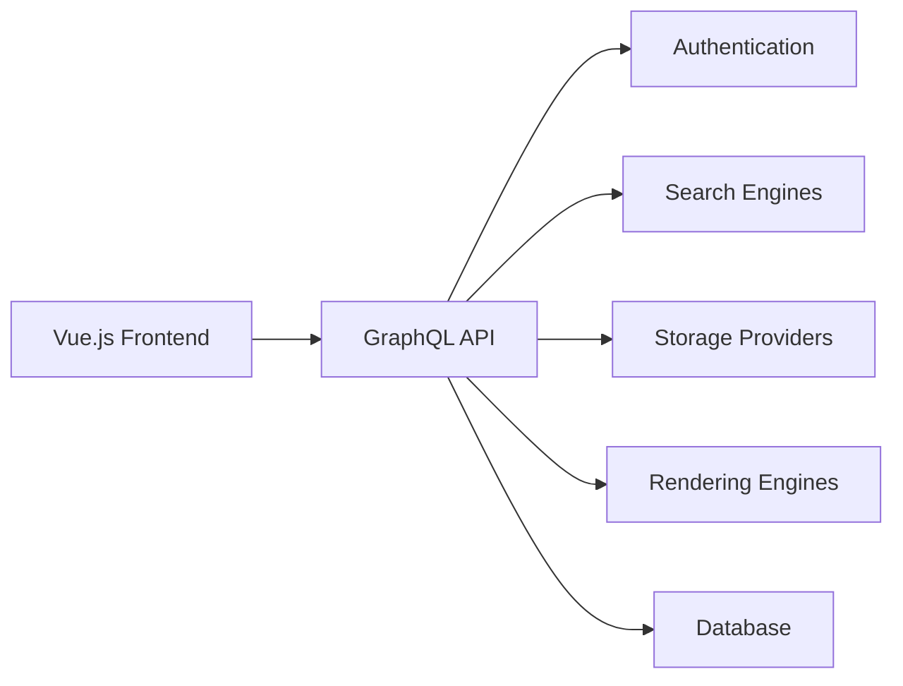

# requarks/wiki

> Beta 3.0 version of the Wiki.js wiki, not recommended for production.

## The problem
Hosting a modern, modular team wiki. The README does not describe the problem further.

## What it actually does
The README is almost empty: it flags a 3.0 beta "NOT FOR PRODUCTION USE" and points to `requarks/wiki-v2` for the stable 2.x version. The architecture, drawn from the code, shows a Vue.js frontend, an Express GraphQL API, and modules for authentication, search, storage, rendering and analytics.

## How it is wired

## Trying it
No command documented in the README: see the official website and the installation documentation.

## Cost and gotchas
Free, but beta: risk of breaking changes. The stable version is elsewhere (`requarks/wiki-v2`).

## What it is not
Not a version usable in production. The diagram was produced from the file tree, without detailed reading of the code.

## Alternatives
`requarks/wiki-v2` (stable 2.x version, cited by the README).

## For you
Ignore for now: explicit beta and empty README; take 2.x if you want a wiki.
