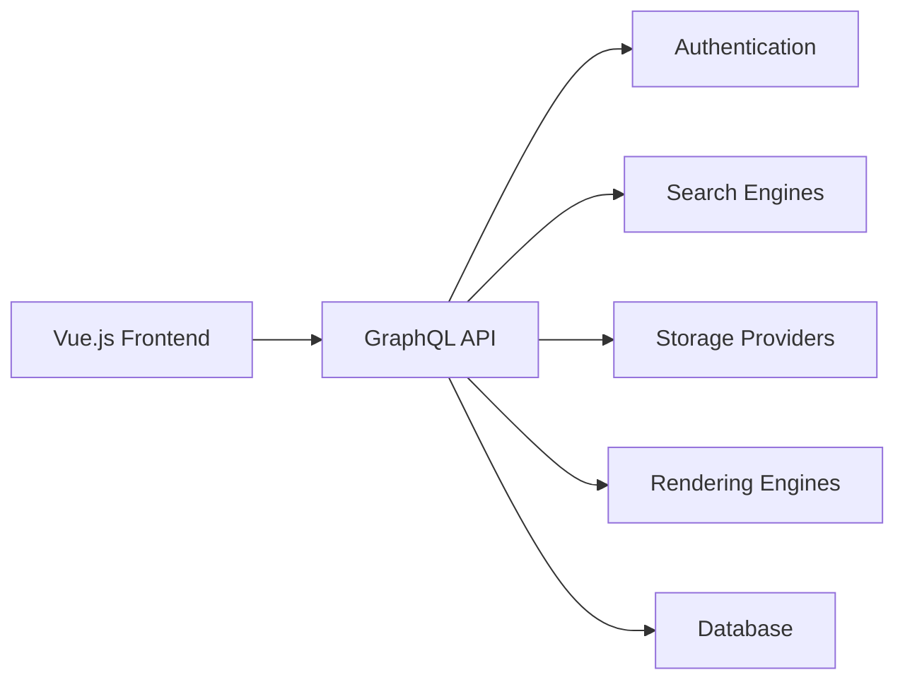

# requarks/wiki

> Version bêta 3.0 du wiki Wiki.js, déconseillée en production.

## Le problème
Héberger un wiki d'équipe moderne et modulaire. Le README ne décrit pas davantage le problème.

## Ce que ça fait vraiment
Le README est quasi vide : il signale une bêta de la 3.0 « NOT FOR PRODUCTION USE » et renvoie à `requarks/wiki-v2` pour la version stable 2.x. L'architecture, tirée du code, montre un frontend Vue.js, une API GraphQL Express, et des modules pour authentification, recherche, stockage, rendu et analytique.

## Comment c'est branché

## Essayer
Aucune commande documentée dans le README : voir le site officiel et la documentation d'installation.

## Coût et pièges
Gratuit, mais bêta : risque de changements cassants. La version stable est ailleurs (`requarks/wiki-v2`).

## Ce que ce n'est pas
Pas une version utilisable en production. Le diagramme a été produit à partir de l'arborescence, sans lecture détaillée du code.

## Alternatives
`requarks/wiki-v2` (version stable 2.x, citée par le README).

## Pour toi
À ignorer pour l'instant : bêta explicite et README vide ; prends la 2.x si tu veux un wiki.

