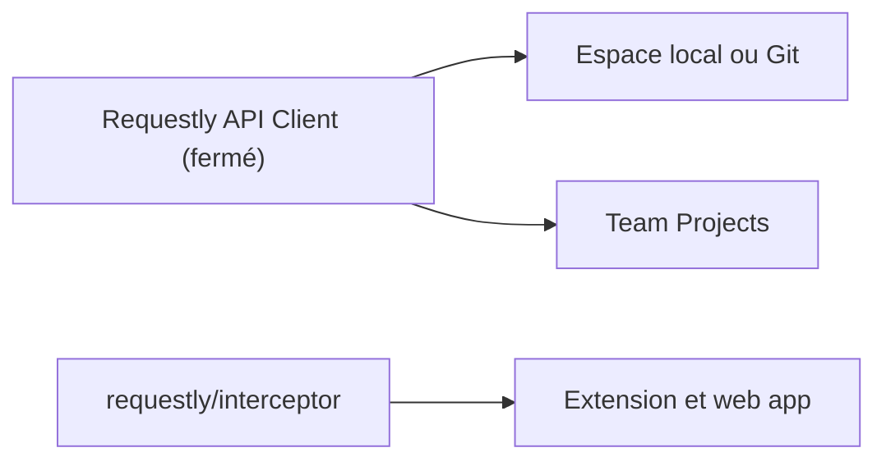

# requestly/requestly

> A Git-synced API client, for those who test APIs, hosted here as a community repository.

## The problem
Testing and sharing collections of API calls goes through heavy, cloud-bound tools.

## What it actually does
The client lets you test REST and GraphQL APIs, with pre- and post-request scripts, import from cURL, Postman and OpenAPI, Git sync and local workspaces. Note: the application is closed source. This repository only serves for bugs, ideas and the roadmap; the interceptor code is elsewhere.

## How it is wired
Simplified diagram based on the fiche, no diagram provided.

## Trying it
The README gives no command: it offers downloads for macOS, Windows and Linux.

## Cost and gotchas
Free up to 10 collaborators, then paid Team and Enterprise plans. Closed application despite the public repository. License present but not identified by GitHub.

## What it is not
Not open source code for the API Client. This repository is not the HTTP interceptor's.

## Alternatives
- Postman: replaced according to the README. The open interceptor is in requestly/interceptor.

## For you
Keep an eye on it: handy for testing model APIs, but the core is closed, so poorly suited if you want to audit or modify the tool.
