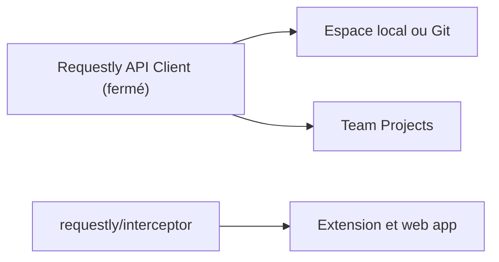

# requestly/requestly

> Un client d'API à synchronisation Git, pour qui teste des API, hébergé ici comme dépôt communautaire.

## Le problème
Tester et partager des collections d'appels d'API passe par des outils lourds, liés à un cloud.

## Ce que ça fait vraiment
Le client permet de tester des API REST et GraphQL, avec scripts avant et après requête, import depuis cURL, Postman et OpenAPI, synchronisation Git et espaces de travail locaux. Attention : l'application est fermée. Ce dépôt ne sert qu'aux bugs, idées et à la feuille de route ; le code de l'intercepteur est ailleurs.

## Comment c'est branché
Schéma simplifié d'après la fiche, sans diagramme fourni.

## Essayer
Le README ne donne aucune commande : il propose des téléchargements pour macOS, Windows et Linux.

## Coût et pièges
Gratuit jusqu'à 10 collaborateurs, puis offres Team et Enterprise payantes. Application fermée malgré le dépôt public. Licence présente mais non identifiée par GitHub.

## Ce que ce n'est pas
Pas du code source ouvert pour l'API Client. Ce dépôt n'est pas celui de l'intercepteur HTTP.

## Alternatives
- Postman : remplacé selon le README. L'intercepteur ouvert est dans requestly/interceptor.

## Pour toi
À surveiller : pratique pour tester des API de modèles, mais le cœur est fermé, donc peu adapté si tu veux auditer ou modifier l'outil.

