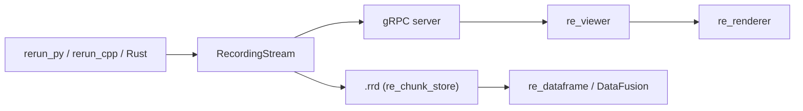

# rerun-io/rerun

> Data layer for physical AI: logs, queries and visualizes multimodal data.

## The problem
Debugging a robot or a vision pipeline with text logs is impossible: you need to see images, point clouds and time series in sync.

## What it actually does
Python, Rust and C++ SDK: you log entities with a timeline (`rr.log`, `rr.set_time`). The native or web viewer displays them in sync; recordings are stored (`.rrd`) and queryable as dataframes or SQL, with streaming to training. Transport via gRPC or file; viewer in Rust with GPU rendering.

## How it is wired


## Trying it
```bash
pip install rerun-sdk
rerun --help
```
```python
import rerun as rr
rr.init("rerun_example_app")
rr.spawn()
```

## Cost and gotchas
Free (Apache-2.0, open-source core). Rerun Hub, a team catalog, is reserved for a few partners. Viewer slow with many entities or point clouds of millions of points.

## What it is not
API still changing ("expect breaking changes"). Not a mere RViz: it also serves as storage and querying.

## Alternatives
- RViz: visualization only, latest state only.

## For you
Adopt for visual debugging of vision pipelines, robotics or sensors: installs with a single `pip install`, with an API that is still moving.
