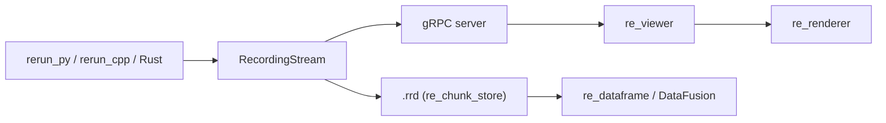

# rerun-io/rerun

> Couche de données pour IA physique : journalise, interroge et visualise des données multimodales.

## Le problème
Déboguer un robot ou un pipeline de vision avec des logs texte est impossible : il faut voir images, nuages de points et séries temporelles synchronisés.

## Ce que ça fait vraiment
SDK Python, Rust et C++ : on journalise des entités avec une ligne temporelle (`rr.log`, `rr.set_time`). Le viewer natif ou web les affiche en synchronisation ; les enregistrements sont stockés (`.rrd`) et interrogeables en dataframes ou SQL, avec flux vers l'entraînement. Transport par gRPC ou fichier ; viewer en Rust avec rendu GPU.

## Comment c'est branché


## Essayer
```bash
pip install rerun-sdk
rerun --help
```
```python
import rerun as rr
rr.init("rerun_example_app")
rr.spawn()
```

## Coût et pièges
Gratuit (Apache-2.0, cœur open source). Rerun Hub, catalogue d'équipe, est réservé à quelques partenaires. Viewer lent avec beaucoup d'entités ou de nuages de millions de points.

## Ce que ce n'est pas
API encore changeante (« attendez-vous à des ruptures »). Pas un simple RViz : sert aussi de stockage et de requêtage.

## Alternatives
- RViz : visualisation seule, dernier état uniquement.

## Pour toi
À adopter pour du débogage visuel de pipelines de vision, robotique ou capteurs : installation en un `pip install`, avec API qui bouge encore.

