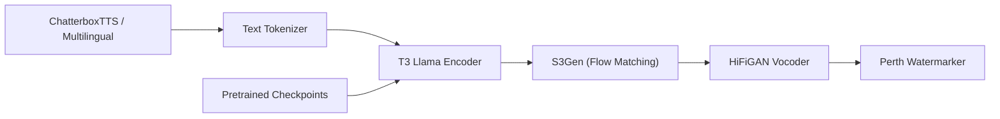

# resemble-ai/chatterbox

> Family of open source text-to-speech models with voice cloning, for agents and multilingual applications.

## The problem
The best synthetic voices are often paid or closed; you need an open model that is controllable and self-deployable.

## What it actually does
Several models: Turbo (350M, English, low latency, tags like `[laugh]`), Nano (110M, runs on CPU, 3 times faster than real time on 8 cores), Multilingual V3 (500M, 23 languages) and six per-language finetunes. A reference audio clip lets you clone a voice. Every generated audio carries a PerTh neural watermark, detectable by script. The architecture (tokenizer, T3 encoder, s3gen, HiFiGAN vocoder) is a PyTorch chain.

## How it is wired


## Trying it
```bash
pip install chatterbox-tts
```
```python
from chatterbox.tts_turbo import ChatterboxTurboTTS
model = ChatterboxTurboTTS.from_pretrained(device="cuda")
wav = model.generate(text, audio_prompt_path="your_10s_ref_clip.wav")
```

## Cost and gotchas
Free; a GPU is advised (Nano allows CPU). Tested on Python 3.11, Debian 11. Voice cloning raises consent questions; the README adds a usage warning. A paid service is optionally offered by the publisher.

## What it is not
Not a hosted service (the paid service is separate). Quality compared with ElevenLabs and others rests on evaluations run by the publisher.

## Alternatives
- ElevenLabs Turbo v2.5, Cartesia Sonic 3 and VibeVoice 7B: compared in the cited Podonos evaluations.

## For you
Adopt: an MIT-licensed TTS model, in sizes suited from CPU to GPU, ideal for prototyping voice agents locally.
