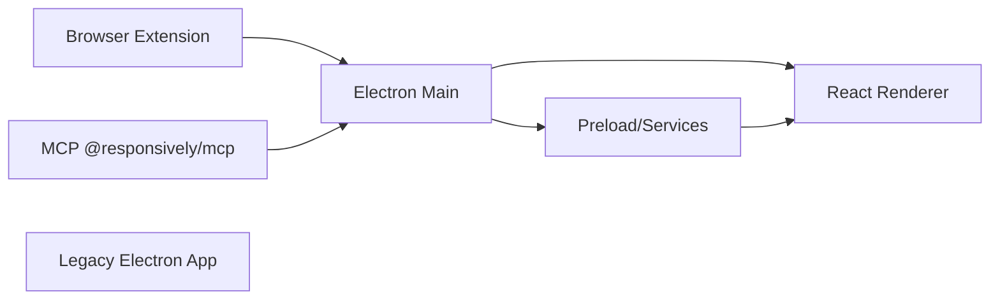

# responsively-org/responsively-app

> Electron browser that displays a page on several devices at once, for web developers.

## The problem
Testing a responsive layout means opening several windows or switching between emulators, without seeing the results side by side.

## What it actually does
Displays the same URL in several device previews (30+ profiles, customizable). Interactions are mirrored across all previews, with a single inspector, one-click screenshots, and hot reload. The README also describes a built-in MCP server, drivable from Claude Code or Cursor, and a browser extension that sends links to the app.

## How it is wired


## Trying it
```bash
brew install --cask responsively
winget install ResponsivelyApp
claude mcp add responsively -- npx -y @responsively/mcp
```

## Cost and gotchas
Free, no account. On Linux, the AppImage must be launched once before connecting an MCP agent. The MCP server listens locally on port 12720.

## What it is not
It is not a real cross-browser test bench: it is an Electron (Chromium) engine, so no Safari or Firefox rendering. A "legacy" folder coexists with the modern app.

## Alternatives
No alternative named in the README.

## For you
Watch: useful for quickly validating the front end of a data app (dashboard, exposed Streamlit), but a web design tool with no direct link to data; the AGPL hinders any reuse of the code.
