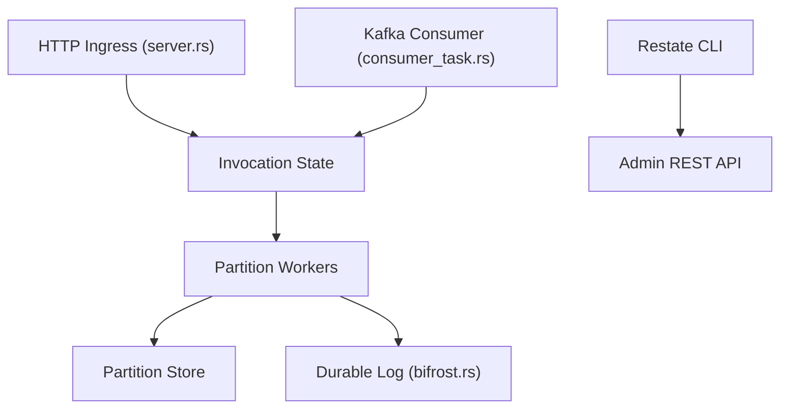

# restatedev/restate

> Durable execution server for workflows, agents and microservices that resume after a failure.

## The problem
A long-running job or an agent that crashes midway restarts from scratch, with duplicates or losses. Hand-coding retries, idempotence and state is tedious.

## What it actually does
A server receives calls (HTTP or Kafka), journals their progress in a durable log and replays the code, skipping the steps already done. It offers per-entity key-value state, durable promises and timers, a CLI and a web interface. SDKs: TypeScript, Java/Kotlin, Python, Go, Rust.

## How it is wired
Diagram based on the one provided.



## Trying it
```bash
brew install restatedev/tap/restate-server
npx @restatedev/restate-server
docker run --rm -p 8080:8080 -p 9070:9070 -p 9071:9071 \
    --add-host=host.docker.internal:host-gateway docker.restate.dev/restatedev/restate:latest
npm install --global @restatedev/restate
```

## Cost and gotchas
Free to self-host; binaries provided for macOS and Linux. It means one more server to operate and an SDK to integrate into each service. A license is present but not recognized by GitHub: read it before commercial use.

## What it is not
Not a retry library to drop into existing code: it is a separate runtime. Not a data pipeline orchestrator in the Airflow sense. The README gives neither benchmark nor comparison.

## Alternatives
No alternative named in the README.

## For you
Worth watching: useful for making long agents or asynchronous inference jobs reliable, but the license to clarify and the server's operating cost justify a targeted trial first.
