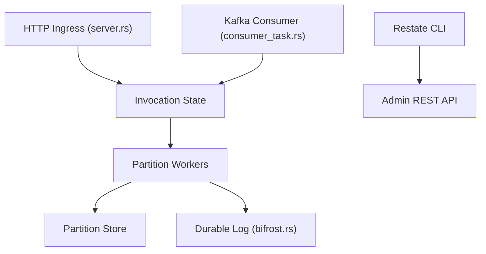

# restatedev/restate

> Serveur d'exécution durable pour workflows, agents et microservices qui reprennent après une panne.

## Le problème
Un traitement long ou un agent qui plante en route repart de zéro, avec des doublons ou des pertes. Coder soi-même retries, idempotence et état est fastidieux.

## Ce que ça fait vraiment
Un serveur reçoit les appels (HTTP ou Kafka), journalise leur progression dans un log durable et rejoue le code en sautant les étapes déjà faites. Il offre un état clé-valeur par entité, des promesses et minuteurs durables, une CLI et une interface web. SDK : TypeScript, Java/Kotlin, Python, Go, Rust.

## Comment c'est branché
Schéma d'après le diagramme fourni.



## Essayer
```bash
brew install restatedev/tap/restate-server
npx @restatedev/restate-server
docker run --rm -p 8080:8080 -p 9070:9070 -p 9071:9071 \
    --add-host=host.docker.internal:host-gateway docker.restate.dev/restatedev/restate:latest
npm install --global @restatedev/restate
```

## Coût et pièges
Gratuit à auto-héberger ; binaires fournis pour macOS et Linux. Il faut un serveur de plus à exploiter et un SDK à intégrer dans chaque service. Licence présente mais non reconnue par GitHub : à lire avant usage commercial.

## Ce que ce n'est pas
Pas une bibliothèque de retries à glisser dans du code existant : c'est un runtime séparé. Pas un orchestrateur de pipelines de données au sens d'Airflow. Le README ne donne ni benchmark ni comparaison.

## Alternatives
Aucune alternative nommée dans le README.

## Pour toi
À surveiller : utile pour fiabiliser des agents longs ou des jobs d'inférence asynchrones, mais la licence à clarifier et le coût d'exploitation du serveur justifient un essai ciblé d'abord.

