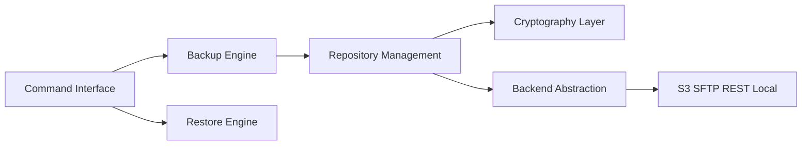

# restic/restic

> Encrypted, deduplicated backup program with many storage backends.

## The problem
Backups get forgotten if they are slow or complicated, and lose their value if restoring cannot be verified.

## What it actually does
`restic init` creates an encrypted repository; `restic backup` records snapshots in it, deduplicated by blocks. The repository layer handles blobs, indexes and packs; the backend layer abstracts storage (local, SFTP, REST, S3, Swift, B2, Azure, Google Cloud, plus rclone). You restore with `restic restore` or mount the snapshots via FUSE.

## How it is wired


## Trying it
```bash
restic init --repo /tmp/backup
restic --repo /tmp/backup backup ~/work
restic restore
restic mount
```

## Cost and gotchas
Free. Losing the repository password makes the data unrecoverable: the README says so. Remote storage (S3, etc.) remains at your expense.

## What it is not
Not a backup on its own: the README reminds you that a copy on the same machine is not a strategy. No built-in scheduling, not documented here.

## Alternatives
No alternative named in the README (rclone is cited as a backend, not as a rival).

## For you
Worth adopting to back up datasets, model artifacts and configurations: encryption, deduplication and reproducible binaries.
