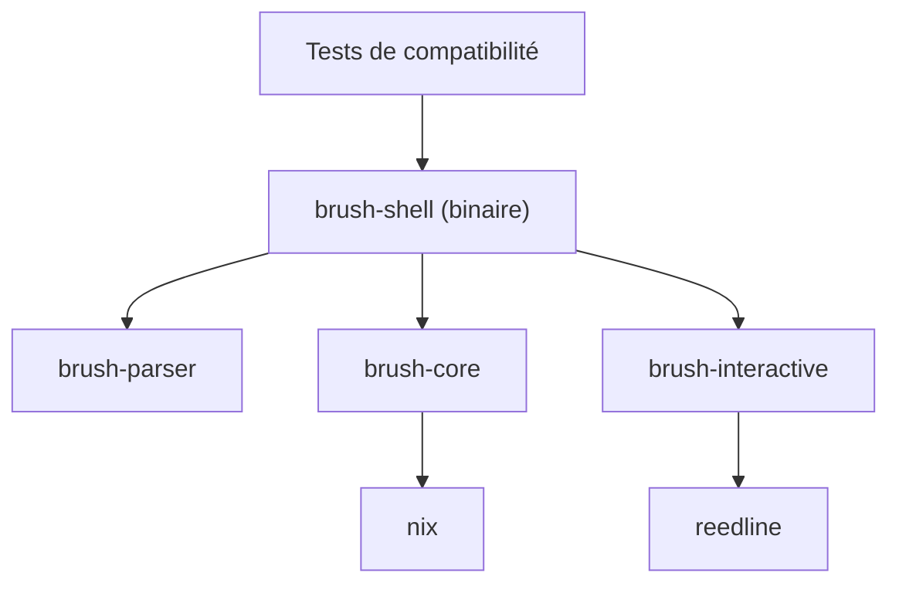

# reubeno/brush

> Bash-compatible shell written in Rust, usable day to day or as an embedded library.

## The problem
Bash is everywhere but cannot easily be embedded or extended in Rust software.

## What it actually does
brush loads existing .bashrc, aliases, functions and completions, runs Bash scripts, handles jobs and adds history suggestions and syntax highlighting. Its engine, brush-core, can be embedded in Rust; brush-parser parses syntax on its own. More than 2,500 test cases compare brush to Bash. The README notes gaps: select, wait -n, disown and some traps.

## How it is wired


## Trying it
```bash
curl --proto '=https' --tlsv1.2 -fsSL https://brush.sh/install.sh | sh
brew install brush
cargo install --locked brush-shell
brush --enable-highlighting
```

## Cost and gotchas
Free. Windows is still in preview and Bash compatibility is partial; the curl-to-sh install script should be read before running it. The repository has 195 open issues.

## What it is not
It is not a complete Bash replacement, nor a different shell like zsh or fish. The precmd and preexec hooks are experimental.

## Alternatives
No alternative named in the README.

## For you
Watch: for personal use, Bash remains safer; the interest is in embedding or parsing shell in a Rust tool.
