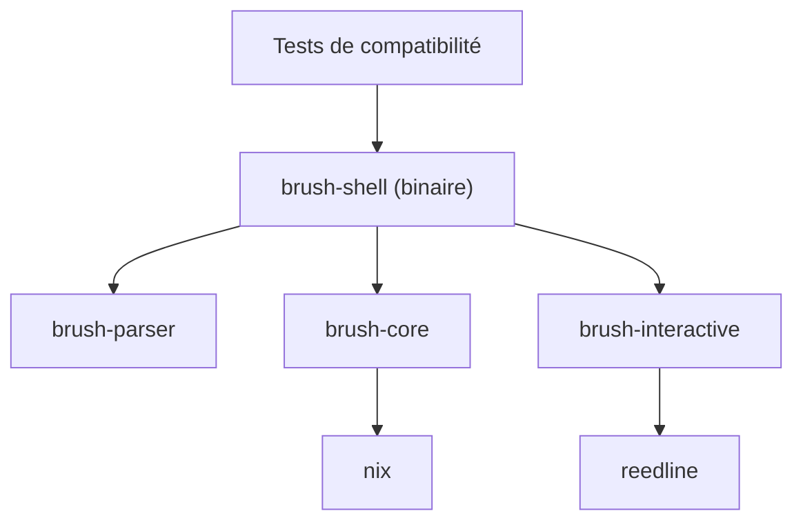

# reubeno/brush

> Shell compatible Bash écrit en Rust, utilisable au quotidien ou comme bibliothèque embarquée.

## Le problème
Bash est partout mais on ne peut pas l'embarquer ni l'étendre facilement dans un logiciel Rust.

## Ce que ça fait vraiment
brush charge .bashrc, alias, fonctions et complétions existants, exécute des scripts Bash, gère les jobs et ajoute suggestions d'historique et coloration syntaxique. Son moteur, brush-core, s'embarque en Rust ; brush-parser analyse la syntaxe seul. Plus de 2 500 cas de test comparent brush à Bash. Le README signale des manques : select, wait -n, disown et certains traps.

## Comment c'est branché


## Essayer
```bash
curl --proto '=https' --tlsv1.2 -fsSL https://brush.sh/install.sh | sh
brew install brush
cargo install --locked brush-shell
brush --enable-highlighting
```

## Coût et pièges
Gratuit. Windows reste en préversion et les compatibilités Bash sont partielles ; le script d'installation par curl vers sh se relit avant de l'exécuter. Le dépôt compte 195 issues ouvertes.

## Ce que ce n'est pas
Ce n'est pas un remplaçant complet de Bash, ni un shell différent comme zsh ou fish. Les crochets precmd et preexec sont expérimentaux.

## Alternatives
Aucune alternative nommée dans le README.

## Pour toi
À surveiller : pour un usage perso, Bash reste plus sûr ; l'intérêt est d'embarquer ou de parser du shell dans un outil Rust.

