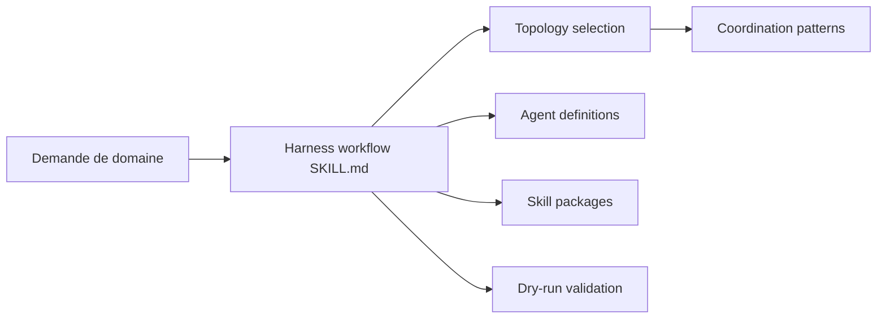

# revfactory/harness

> Claude Code plugin that generates, from a domain description, a team of agents and their skills.

## The problem
Designing a Claude Code agent team by hand (roles, skills, orchestration) is slow and hard to reproduce.

## What it actually does
One sentence triggers a skill that analyzes the domain, picks among six architectures (pipeline, fan-out, expert pool, producer-reviewer, supervisor, hierarchical delegation), generates `.claude/agents/` and `.claude/skills/`, then tests the triggers. v2 targets workflow, persistent agents or subagents, and adds `/harness:evolve`. It is Markdown content, not a service.

## How it is wired


## Trying it
```bash
/plugin marketplace add revfactory/harness
/plugin install harness@harness-marketplace
cp -r skills/harness ~/.claude/skills/harness
```

## Cost and gotchas
Free, but each generated agent consumes your Claude tokens. Discrepancy: the code analysis still mentions the experimental flag, which the v2 README says was removed.

## What it is not
Not a quality guarantee: the announced gains (+60%, n=15) are measured by the author on v1; the README advises a pilot trial.

## Alternatives
None named in the README apart from revfactory/claude-code-harness (v1 results).

## For you
Watch: good generator of agent team skeletons, but results not independently verified and heavy dependence on how Claude Code evolves.
