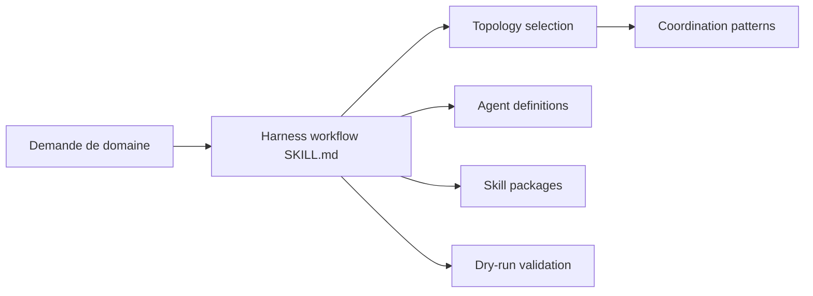

# revfactory/harness

> Plugin Claude Code qui génère, depuis une description de domaine, une équipe d'agents et leurs skills.

## Le problème
Concevoir à la main une équipe d'agents Claude Code (rôles, skills, orchestration) est long et peu reproductible.

## Ce que ça fait vraiment
Une phrase déclenche un skill qui analyse le domaine, choisit parmi six architectures (pipeline, éventail, pool d'experts, producteur-relecteur, superviseur, délégation hiérarchique), génère `.claude/agents/` et `.claude/skills/`, puis teste les déclencheurs. La v2 cible workflow, agents persistants ou sous-agents, et ajoute `/harness:evolve`. C'est du contenu Markdown, pas un service.

## Comment c'est branché


## Essayer
```bash
/plugin marketplace add revfactory/harness
/plugin install harness@harness-marketplace
cp -r skills/harness ~/.claude/skills/harness
```

## Coût et pièges
Gratuit, mais chaque agent généré consomme tes jetons Claude. Divergence : l'analyse du code évoque encore l'indicateur expérimental, que la v2 du README dit supprimé.

## Ce que ce n'est pas
Pas une garantie de qualité : les gains annoncés (+60 %, n=15) sont mesurés par l'auteur sur la v1 ; le README conseille un essai pilote.

## Alternatives
Aucune nommée dans le README hors revfactory/claude-code-harness (résultats v1).

## Pour toi
À surveiller : bon générateur de squelettes d'équipes d'agents, mais résultats non vérifiés indépendamment et dépendance forte à l'évolution de Claude Code.

