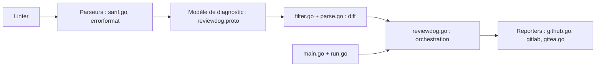

# reviewdog/reviewdog

> Tool that turns the output of any linter into review comments on changed lines.

## The problem
Linters produce noise across all the code; in PR review, you only want the problems introduced by the diff.

## What it actually does
Reads a linter's output (errorformat, rdjson, checkstyle, SARIF, diff), compares it to the diff, filters the results and publishes them: locally, in GitHub Checks, in PR comments, in GitLab, Gerrit, Bitbucket. Can run tools declared in `.reviewdog.yml`, propose code suggestions and fail according to a severity level.

## How it is wired


## Trying it
```bash
curl -sfL https://raw.githubusercontent.com/reviewdog/reviewdog/fd59714416d6d9a1c0692d872e38e7f8448df4fc/install.sh | sh -s
golint ./... | reviewdog -f=golint -diff="git diff FETCH_HEAD"
reviewdog -diff="git diff FETCH_HEAD" -runners=golint,govet
```

## Cost and gotchas
Free. An API token is required to publish (`REVIEWDOG_GITHUB_API_TOKEN`, etc.). The GitHub App option depends on a server maintained by the author, with no availability guarantee (the README says so).

## What it is not
It is not a linter: it detects nothing itself. On PRs from forks, limited permissions only allow annotations.

## Alternatives
- reviewdog/action-setup and the public actions (hadolint, shellcheck, etc.): for GitHub Actions.

## For you
Adopt: plug ruff, mypy, sqlfluff or hadolint into CI to comment only on changed code, without changing your linters.
