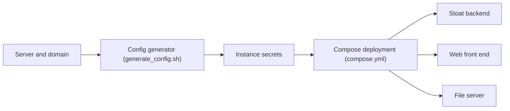

# revoltchat/self-hosted

> Docker Compose configuration to self-host a Stoat (formerly Revolt) instance, for server operators.

## The problem
Deploying a full messaging stack (backend, web, files, proxy, video) yourself without assembling it piece by piece.

## What it actually does
The repository does not contain the application but the configuration: `generate_config.sh` creates `Revolt.toml` and `secrets.env`, `compose.yml` starts the backend, web front end, file server, metadata/image proxy and Caddy. It covers updates, migrations (MinIO to silo, Autumn), LiveKit ports and security notices.

## How it is wired

The contents of Compose and Caddy were not inspected.

## Trying it
```bash
git clone https://github.com/stoatchat/self-hosted stoat
cd stoat
chmod +x ./generate_config.sh
./generate_config.sh your.domain
docker compose up -d
```

## Cost and gotchas
Server with 2 vCPU and 2 GB minimum, a domain, ports 80/443/7881 and 50000-50100/udp. Back up `secrets.env`: losing it cuts off access to files. Exposing the database opens public access despite ufw.

## What it is not
Not the Stoat code. Most official clients do not support self-hosted instances. AGPL-3.0 license.

## Alternatives
No alternative named in the README.

## For you
Ignore for a data/AI profile: it is messaging hosting unrelated to your field.
