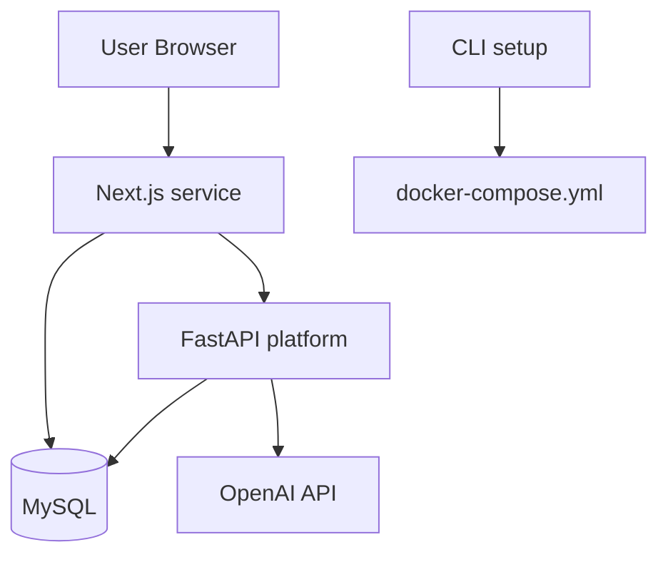

# reworkd/AgentGPT

> Web application to name an autonomous agent and give it a goal, with a task loop.

## The problem
Trying out autonomous agents without programming them.

## What it actually does
You give a goal; the agent invents tasks, runs them and learns from the results. A CLI prepares the environment variables, a MySQL database, a FastAPI backend and a Next.js frontend, all under Docker Compose. Calls go to OpenAI, with Serper and Replicate optional.

## How it is wired


## Trying it
```bash
git clone https://github.com/reworkd/AgentGPT.git
cd AgentGPT
./setup.sh
```

## Cost and gotchas
An OpenAI key is required (billing is on you), Docker and Node are required. The repository is archived, last push in April 2025.

## What it is not
It is not a reliable or maintained agent: it is a demo from the 2023 AutoGPT wave.

## Alternatives
No alternative named in the README.

## For you
Ignore: archived and old, with a heavy stack for a demonstration.
