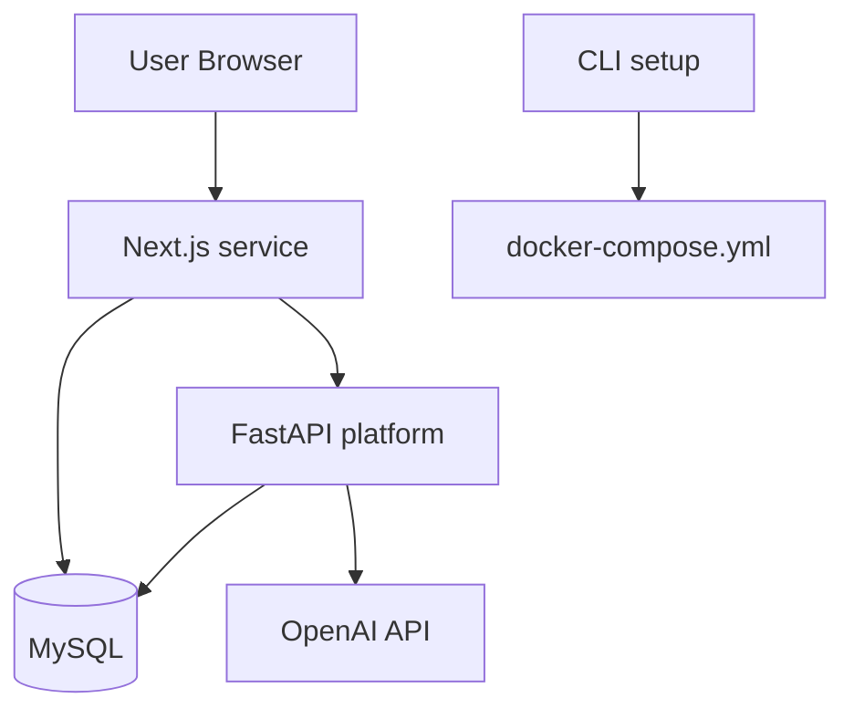

# reworkd/AgentGPT

> Application web pour nommer un agent autonome et lui donner un objectif, avec boucle de tâches.

## Le problème
Essayer des agents autonomes sans les programmer.

## Ce que ça fait vraiment
Tu donnes un objectif ; l'agent invente des tâches, les exécute et apprend des résultats. Un CLI prépare les variables d'environnement, une base MySQL, un backend FastAPI et un frontend Next.js, le tout sous Docker Compose. Les appels partent vers OpenAI, avec Serper et Replicate en option.

## Comment c'est branché


## Essayer
```bash
git clone https://github.com/reworkd/AgentGPT.git
cd AgentGPT
./setup.sh
```

## Coût et pièges
Clé OpenAI obligatoire (facturation à ta charge), Docker et Node requis. Dépôt archivé, dernier push en avril 2025.

## Ce que ce n'est pas
Ce n'est pas un agent fiable ni maintenu : c'est une démo de la vague AutoGPT de 2023.

## Alternatives
Aucune alternative nommée dans le README.

## Pour toi
À ignorer : archivé et ancien, avec une pile lourde pour une démonstration.

