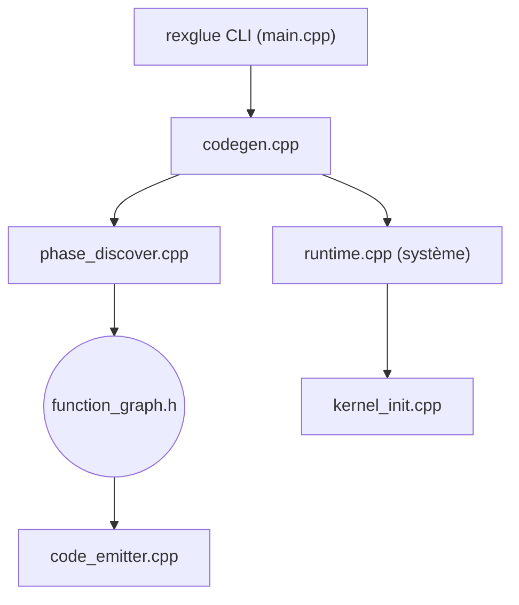

# rexglue/rexglue-sdk

> SDK that converts Xbox 360 PowerPC code into portable C++, for porting developers.

## The problem
Running an Xbox 360 game on modern platforms goes through emulation or JIT, which are heavy and imprecise.

## What it actually does
Static recompilation: analysis of the guest binary, function graph, pass phases, C++ emission via templates. The SDK also provides a runtime that imitates the Xbox kernel (xboxkrnl, XAM), the virtual file system, audio, input and D3D12 and Vulkan graphics backends. The rexglue command-line tool drives the generation.

## How it is wired


## Trying it
```bash
# Aucune commande dans le README : voir le wiki (démarrage rapide et CLI).
```

## Cost and gotchas
Free. You must own the games and files. Early development, breaking API changes expected. License present but not recognized by GitHub.

## What it is not
Not an emulator. The README states it does not encourage piracy.

## Alternatives
Xenia (emulator) and XenonRecomp, from which it draws inspiration.

## For you
Ignore: a game porting tool unrelated to your field, and the license needs clarifying.
