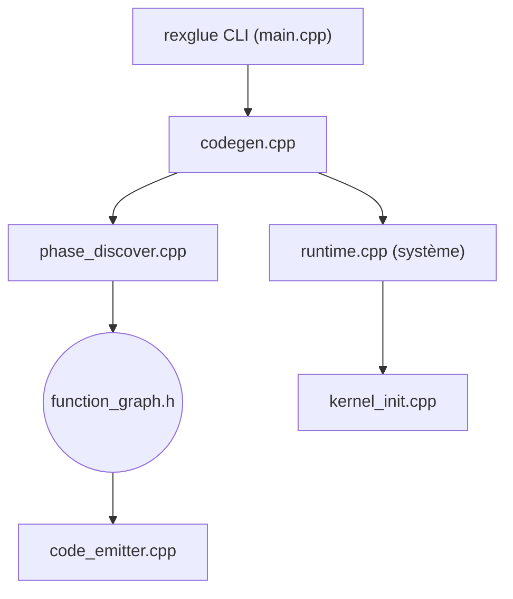

# rexglue/rexglue-sdk

> SDK qui convertit du code PowerPC de la Xbox 360 en C++ portable, pour développeurs de portages.

## Le problème
Faire tourner un jeu Xbox 360 sur plateformes modernes passe par l'émulation ou le JIT, lourds et imprécis.

## Ce que ça fait vraiment
Recompilation statique : analyse du binaire invité, graphe de fonctions, phases de passes, émission de C++ via des gabarits. Le SDK fournit aussi un runtime qui imite le noyau Xbox (xboxkrnl, XAM), le système de fichiers virtuel, l'audio, l'entrée et des backends graphiques D3D12 et Vulkan. L'outil en ligne de commande rexglue pilote la génération.

## Comment c'est branché


## Essayer
```bash
# Aucune commande dans le README : voir le wiki (démarrage rapide et CLI).
```

## Coût et pièges
Gratuit. Il faut posséder les jeux et fichiers. Développement précoce, API cassantes attendues. Licence présente mais non reconnue par GitHub.

## Ce que ce n'est pas
Pas un émulateur. Le README précise ne pas encourager le piratage.

## Alternatives
Xenia (émulateur) et XenonRecomp, dont il s'inspire.

## Pour toi
À ignorer : outil de portage de jeux sans rapport avec ton métier, et licence à clarifier.

