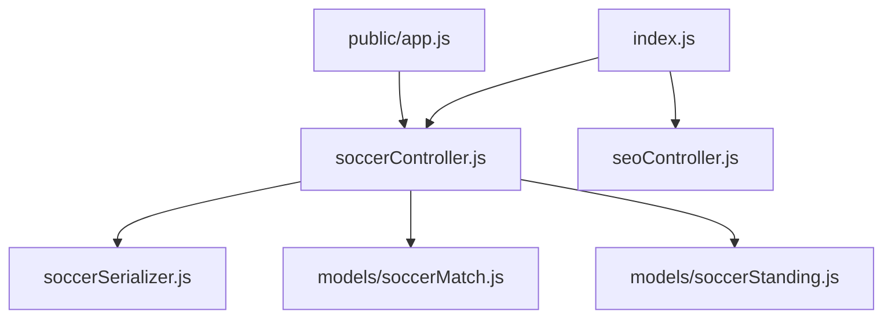

# rezarahiminia/worldcup2026

> REST API and live football scores site (Premier League, LaLiga), reading a MongoDB database.

## The problem
Getting scores, fixtures, standings and match events without paying for a commercial API.

## What it actually does
`index.js` starts a Node server that reads MongoDB and exposes `/get/soccer/{league}/...` (scoreboard, fixtures, summary, clubs, standings). It does not fill the database: an external "listener", not provided, fetches the upstream data and writes it there. SEO pages and a public interface are included.

## How it is wired


## Trying it
```bash
npm install
npm run db:init-live
npm start
curl "http://localhost:3050/get/soccer/eng.1/scoreboard?dates=20260822"
```

## Cost and gotchas
You need Node 20+, MongoDB 6+ and the external listener: without it, the database is empty. API keys and per-client quotas are not implemented, and no license is declared.

## What it is not
Not a standalone data source: freshness depends entirely on the listener, and only England and Spain are covered.

## Alternatives
No alternative named in the README.

## For you
Ignore: without the listener or a license, you only get half a service; for football data, look for a maintained source.
