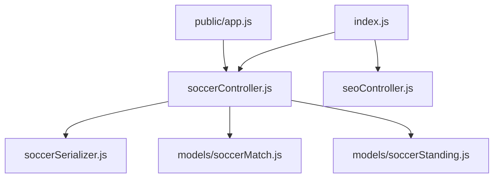

# rezarahiminia/worldcup2026

> API REST et site de scores de football en direct (Premier League, LaLiga), lisant une base MongoDB.

## Le problème
Obtenir scores, calendriers, classements et événements de match sans payer une API commerciale.

## Ce que ça fait vraiment
`index.js` lance un serveur Node qui lit MongoDB et expose `/get/soccer/{league}/...` (scoreboard, fixtures, summary, clubs, standings). Il ne remplit pas la base : un « listener » externe, non fourni, récupère les données amont et les y écrit. Pages SEO et interface publique incluses.

## Comment c'est branché


## Essayer
```bash
npm install
npm run db:init-live
npm start
curl "http://localhost:3050/get/soccer/eng.1/scoreboard?dates=20260822"
```

## Coût et pièges
Il faut Node 20+, MongoDB 6+ et le listener externe : sans lui, la base est vide. Les clés d'API et quotas par client ne sont pas implémentés, et aucune licence n'est déclarée.

## Ce que ce n'est pas
Pas une source de données autonome : la fraîcheur dépend entièrement du listener, et seules l'Angleterre et l'Espagne sont couvertes.

## Alternatives
Aucune alternative nommée dans le README.

## Pour toi
À ignorer : sans le listener ni licence, tu n'as qu'une moitié de service ; pour du football en data, cherche une source maintenue.

