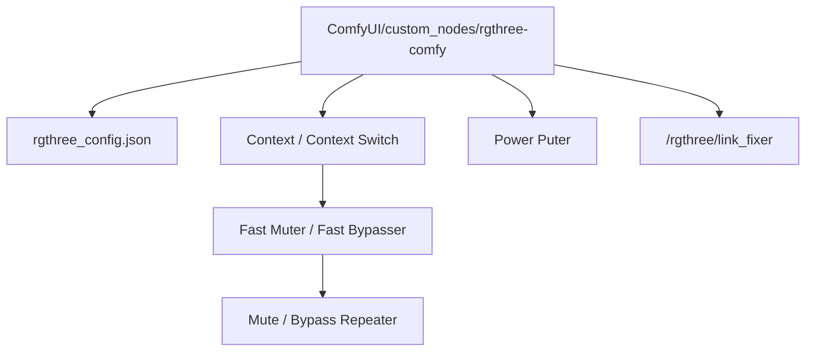

# rgthree/rgthree-comfy

> Collection of nodes for ComfyUI that tidies up workflows and avoids useless computation.

## The problem
A ComfyUI workflow that keeps growing turns into spaghetti, and the usual switches
leave branches running that you thought were cut: GPU burned for nothing.

## What it actually does
Provides a `Context` / `Context Switch` that passes through the first non-empty context, a
`Fast Muter` / `Fast Bypasser` acting as a dashboard to cut nodes or groups
with one click, a `Power Lora Loader` that stacks several LoRAs in a single node, and a
`Power Puter` that evaluates multi-line expressions to produce an integer, a float, a
string or a boolean. It also adds a progress bar, execution of only the selected output nodes, and a
broken-link fixer served at `/rgthree/link_fixer`.

## How it is wired


## Trying it
```bash
cd ComfyUI/custom_nodes
git clone https://github.com/rgthree/rgthree-comfy.git
```
Then start ComfyUI. Settings are under right-click on the graph background, `rgthree-comfy > Settings`.

## Cost and gotchas
Free, with no key or third-party service, but entirely dependent on ComfyUI: the author warns
that a ComfyUI change can break the extension, hence the per-feature switch.

## What it is not
It is not a team project: the author writes that they built it for their own use. It is not
a universal compatibility layer — several nodes are marked deprecated or
experimental, and some features are disabled by default. The README declares
no license.

## Alternatives
- ComfyUI alone — the recent version fixed the execution recursion that this repo was working around.
- `Power Lora Loader` replaces the `Lora Loader Stack` from the same repo, which is deprecated.

## For you
Worth knowing if you work with ComfyUI; outside of that, no benefit for a data or MLOps pipeline.
