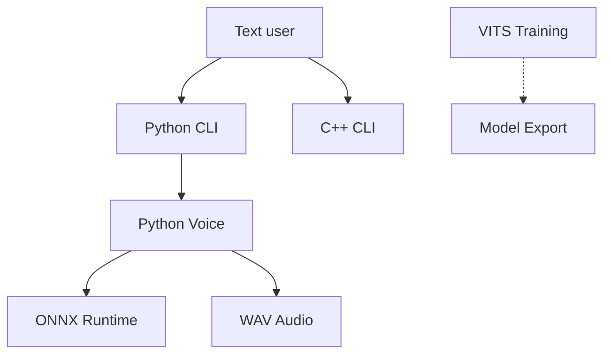

# rhasspy/piper

> Local neural text-to-speech, whose development has moved to another repository.

## The problem
Generate voice locally, without a cloud API, from text.

## What it actually does
The README contains only a pointer: development continues at OHF-Voice/piper1-gpl. Based on the architecture: a Python CLI, HTTP server and C++ executable that synthesize text into WAV with an ONNX model, voice downloading, then a VITS training chain (preprocessing, training, ONNX export, voice conversion).

## How it is wired

## Trying it
No command documented in the README.

## Cost and gotchas
Free. Archived repository, last push in August 2025. The successor is cited under the name piper1-gpl.

## What it is not
It is no longer Piper's active repository, and the README describes neither installation nor usage.

## Alternatives
OHF-Voice/piper1-gpl, where development continued.

## For you
Ignore: archived; if local speech synthesis interests you, look at piper1-gpl.
