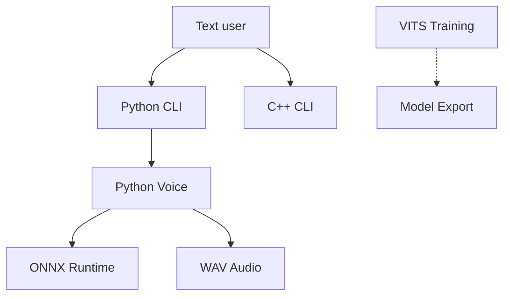

# rhasspy/piper

> Synthèse vocale neuronale locale, dont le développement a déménagé vers un autre dépôt.

## Le problème
Générer de la voix localement, sans API cloud, à partir de texte.

## Ce que ça fait vraiment
Le README ne contient qu'un renvoi : le développement continue sur OHF-Voice/piper1-gpl. D'après l'architecture : CLI Python, serveur HTTP et exécutable C++ qui synthétisent du texte en WAV avec un modèle ONNX, téléchargement de voix, puis chaîne d'entraînement VITS (prétraitement, entraînement, export ONNX, conversion de voix).

## Comment c'est branché

## Essayer
Aucune commande documentée dans le README.

## Coût et pièges
Gratuit. Dépôt archivé, dernier push en août 2025. Le successeur est cité sous le nom piper1-gpl.

## Ce que ce n'est pas
Ce n'est plus le dépôt actif de Piper, et le README ne décrit ni installation ni usage.

## Alternatives
OHF-Voice/piper1-gpl, où le développement a continué.

## Pour toi
À ignorer : archivé ; si la synthèse vocale locale t'intéresse, regarde piper1-gpl.

